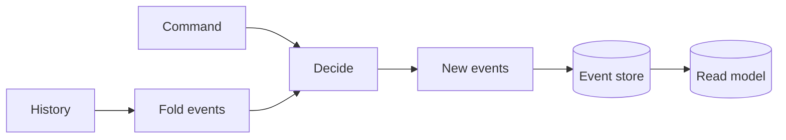

# Event-Sourced Orders

[](https://github.com/borikhan/event-sourced-orders/actions/workflows/ci.yml)
[](https://www.typescriptlang.org/)

A compact CQRS and event-sourcing reference service in strict TypeScript. Business commands are validated against aggregate state, accepted changes become immutable events, state is rebuilt by folding history, and writes require the expected stream version.

## Engineering highlights

- Command decision and event evolution are separate pure functions
- Illegal order transitions fail before persistence
- Optimistic concurrency detects competing writers
- The event stream is the source of truth; projections are rebuildable
- Native Node tests validate totals and lifecycle invariants



## Run locally

```bash
npm ci
npm run build
npm test
npm run dev
```

The HTTP layer accepts commands and exposes order state plus raw event history. Read [architecture and operations](docs/architecture.md) for consistency, event evolution, projection recovery, and twelve-factor deployment.

## License

MIT
